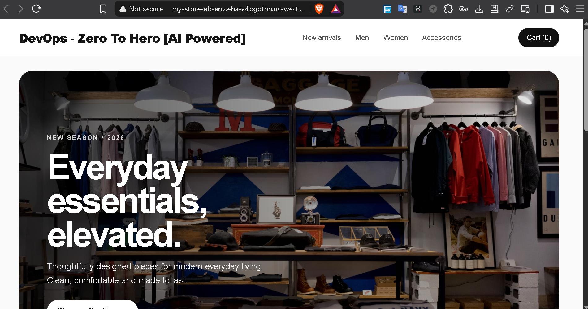
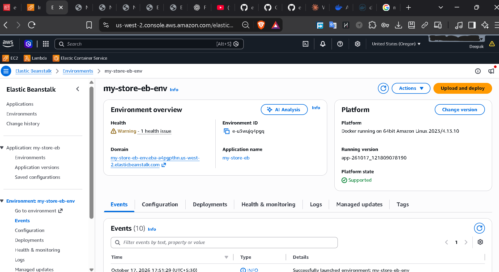
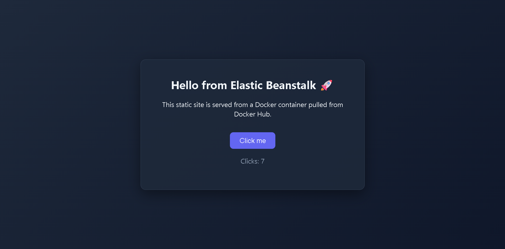
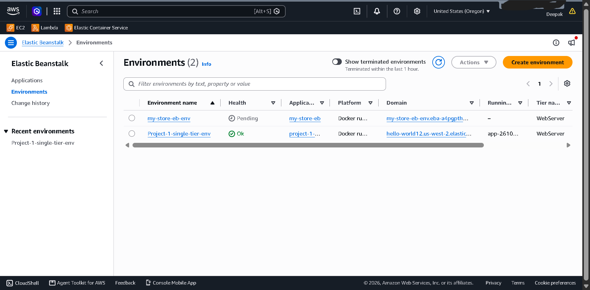

# AWS Elastic Beanstalk — Docker Deployment

Deploying a Dockerized web app to **AWS Elastic Beanstalk** using an image hosted on **Docker Hub**, provisioned and managed with the **EB CLI** from an EC2 instance.

This repo documents the full workflow end-to-end: building a Docker image, pushing it to Docker Hub, initializing an Elastic Beanstalk application, and deploying it to a live environment.

> Reference project used while learning this workflow: [elastic-beanstalk-in-one-shot](https://github.com/LondheShubham153/elastic-beanstalk-in-one-shot) by [@LondheShubham153](https://github.com/LondheShubham153)

---

## Architecture

```
 ┌─────────────┐      docker build      ┌─────────────┐
 │  Dockerfile │ ─────────────────────▶ │ Local Image │
 └─────────────┘                        └──────┬──────┘
                                                │ docker push
                                                ▼
                                       ┌─────────────────┐
                                       │   Docker Hub     │
                                       │  (public repo)   │
                                       └────────┬─────────┘
                                                │ pulled by EB
                                                ▼
                        ┌───────────────────────────────────────┐
                        │     AWS Elastic Beanstalk Environment   │
                        │  (Docker platform on Amazon Linux 2023) │
                        │                                         │
                        │   EC2 instance → runs container → :80   │
                        └───────────────────┬─────────────────────┘
                                             │
                                             ▼
                                   Public EB environment URL
```

Elastic Beanstalk doesn't build the image itself — `Dockerrun.aws.json` tells it which image to **pull from Docker Hub** and which container port to expose.

---

## Tech Stack

- **Frontend:** HTML, CSS, JavaScript (static site)
- **Containerization:** Docker, nginx:alpine base image
- **Registry:** Docker Hub
- **Deployment platform:** AWS Elastic Beanstalk (Docker platform, Amazon Linux 2023)
- **Tooling:** AWS CLI, EB CLI, EC2 (Ubuntu)

---

## Project Structure

```
.
├── app/
│   ├── index.html
│   ├── style.css
│   ├── script.js
│   └── Dockerfile
├── Dockerrun.aws.json
├── screenshots/
└── README.md
```

---

## Deployment Steps

### 1. Build the Docker image

```bash
cd app
docker build -t user_name/eb-docker-app:latest .
```

### 2. Push to Docker Hub

```bash
docker login
docker push deepak8103/eb-docker-app:latest
```

### 3. Point Elastic Beanstalk at the image

`Dockerrun.aws.json` (at the repo root) tells EB which image to pull:

```json
{
  "AWSEBDockerrunVersion": "1",
  "Image": {
    "Name": "deepak8103/eb-docker-app:latest",
    "Update": "true"
  },
  "Ports": [
    { "ContainerPort": "80" }
  ]
}
```

### 4. Initialize the EB application

```bash
aws configure                 # set access key, secret key, region
eb init my-store-eb --platform docker --region us-west-2
```

### 5. Create and deploy the environment

```bash
eb create my-store-eb-env \
  --single \
  --instance-type t3.micro \
  --instance_profile aws-elasticbeanstalk-ec2-role \
  --service-role aws-elasticbeanstalk-service-role
```

### 6. Verify

```bash
eb status
eb open
```

### 7. Ship updates

Whenever the app changes:

```bash
docker build -t deepak8103/eb-docker-app:latest .
docker push user_name/eb-docker-app:latest
eb deploy
```

`"Update": "true"` in `Dockerrun.aws.json` means EB pulls the fresh `latest` tag on every redeploy.

---

## Screenshots

**Live environment — e-commerce storefront on Elastic Beanstalk**


**Elastic Beanstalk environment overview**
Environment running on the Docker platform (Amazon Linux 2023), health status, environment ID, and domain.


**Docker Hub image running live**
Simple container app deployed from the Docker Hub image.


**Elastic Beanstalk — Environments list**
Multiple environments running side by side under the same AWS account.


---

## Key Learnings

- **Credentials matter at every layer** — `eb init` fails with an invalid security token if AWS CLI credentials aren't configured (`aws configure`) or an EC2 instance role doesn't have Elastic Beanstalk permissions.
- **`Dockerrun.aws.json` is the bridge** between Docker Hub and Elastic Beanstalk — it's how EB knows which image to pull, rather than building from source.
- **Docker Hub repos must be public** for EB to pull them without extra registry authentication setup.
- **`docker` group membership** avoids needing `sudo` for every Docker command — requires a fresh shell session (`newgrp docker` or re-login) to take effect.
- **EB CLI needs its own Python environment** in some setups (`python3 -m venv` + `pip install awsebcli`) to avoid conflicts with system Python packages.

---

## Author

**Deepak Otari**
Targeting DevOps / Cloud / AI-ML roles.
GitHub: [@deepak-mlops](https://github.com/deepak-mlops)
